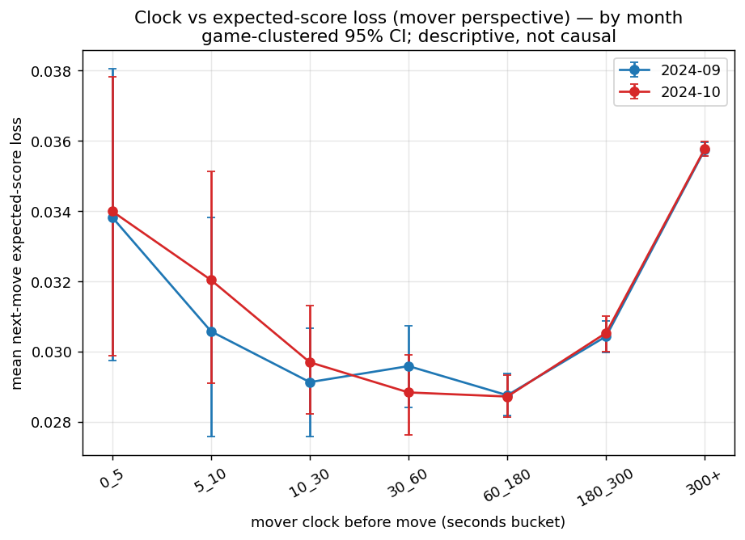
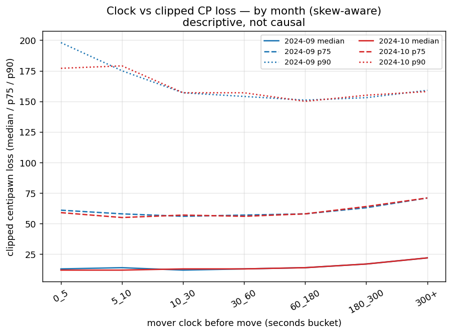
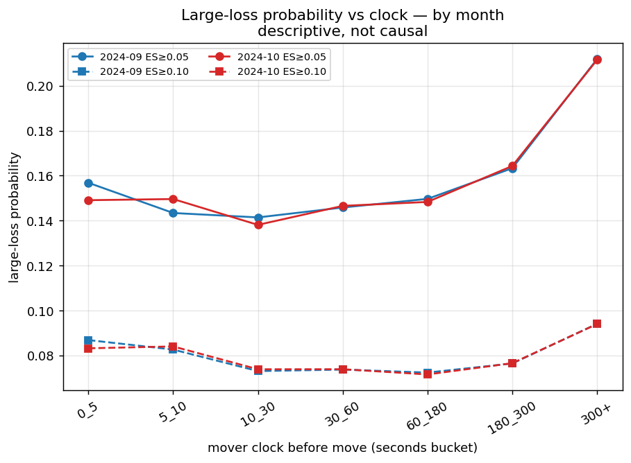
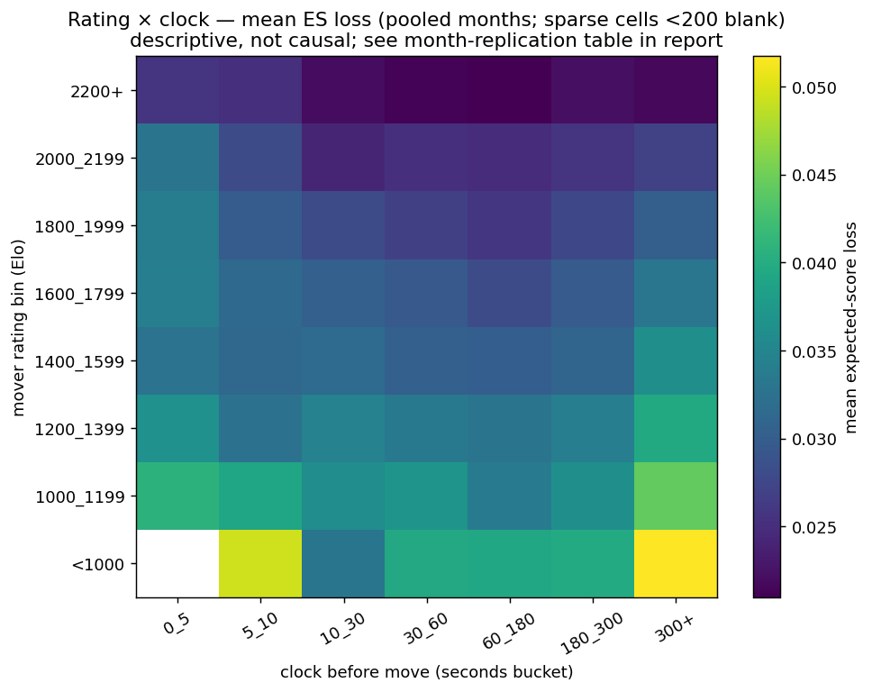
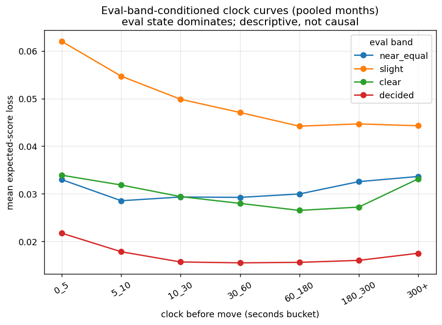
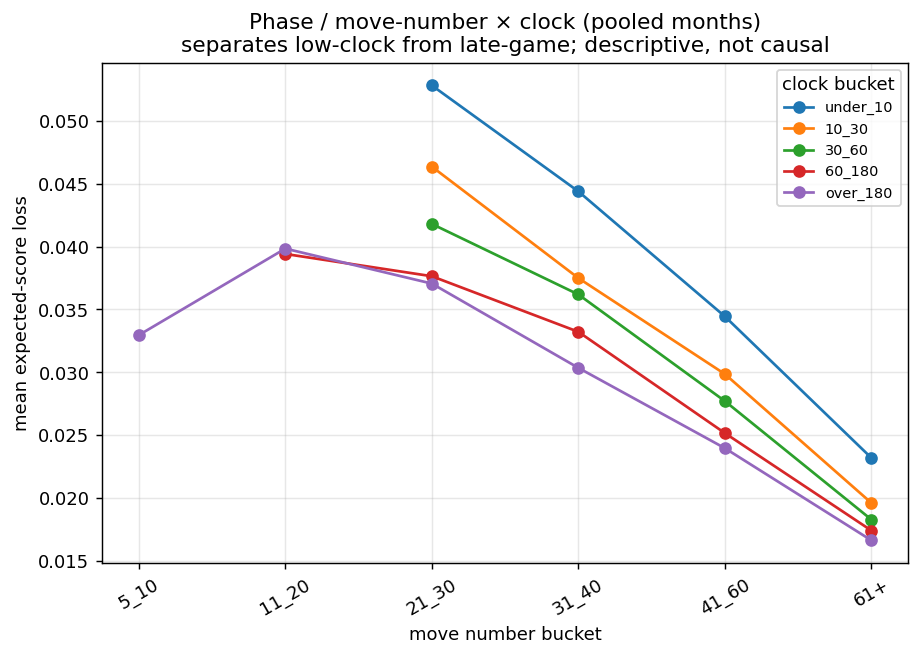
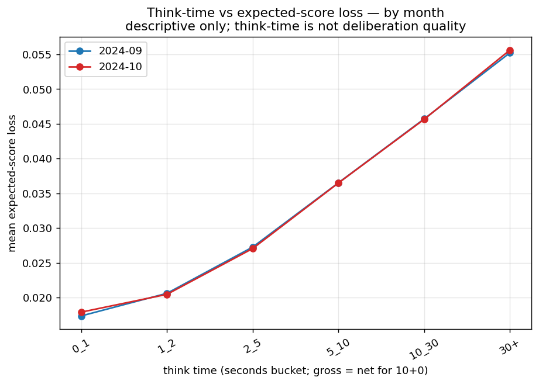
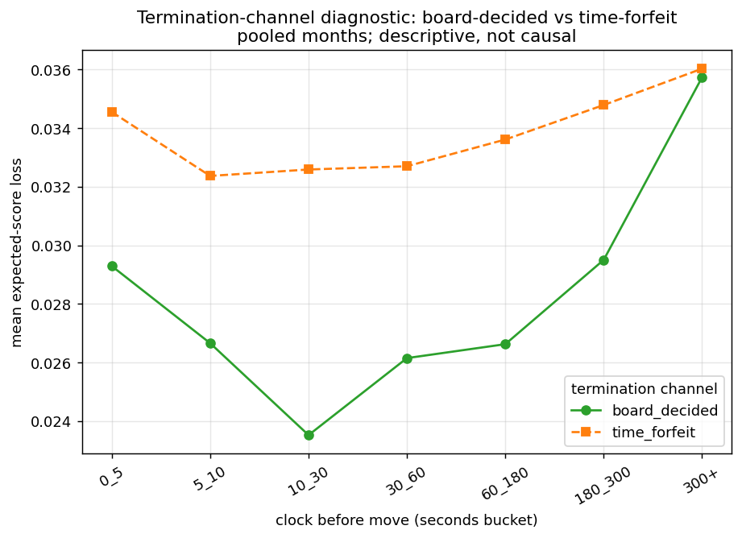
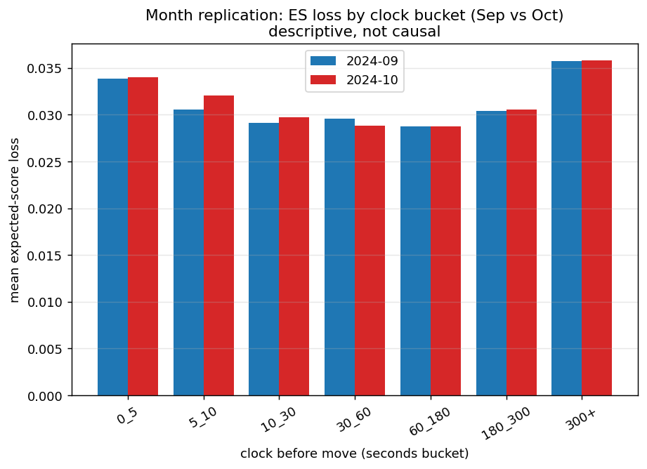

# CP / ES Constraint Atlas — 10+0, 2024-09 and 2024-10

**Ticket:** 15.4B — CP/ES Constraint Atlas Visualization Implementation
**Bootstrap:** 500 game-clustered draws, seed 20240617

## 1. Executive summary

Descriptive per-ply move-quality atlas over the dense 10+0 substrate (2024-09 + 2024-10, both colors, move_number≥5, depth 12). Headline metric: next-move **expected-score loss** (mover perspective); clipped centipawn loss is the secondary, skew-aware view. Every headline figure is shown for both months. **Predictive/descriptive only — not causal, not a degradation curve; Stockfish eval is objective position context, not ground truth.** The dominant axis is eval state; clock and think-time associations are read descriptively.

## 2. Inputs and validation

- Combined rows loaded: 2,933,756; months: 2024_09, 2024_10.
- Schema validated: required columns present; no raw-username columns; expected_score_loss ∈ [0,1]; clipped cp ≥ 0; time control uniformly 600+0 / 600 / 0 / rapid; per-month row counts match 15.3C/15.3D.

| month | rows (expected) |
|---|---|
| 2024_09 | 1,496,890 (1496890) |
| 2024_10 | 1,436,866 (1436866) |

## 3. Filtering policy and denominators

- Headline rows = status OK ∧ not mate-band ∧ both colors: **2,778,772**.
- Mate-band rows excluded from headline (diagnostic only): 154,984.
- Clock/think anomalies are flagged, never dropped (see §14).

## 4. Metric policy

- PRIMARY: `expected_score_loss` (mover perspective). SECONDARY: `cp_loss_clipped` (median/p75/p90). DIAGNOSTIC-only: `cp_loss_raw`. Large-loss: ES≥0.05, ES≥0.10, cp≥100, cp≥200. %-eval-swing forbidden as headline.

## 5. Clock vs expected-score loss

**2024-09** ES loss by clock bucket (mean [95% CI], n):

| clock bucket | n | mean | 95% CI | cell |
|---|---|---|---|---|
| 0_5 | 2,487 | 0.0338 | [0.0297, 0.0380] | headline |
| 5_10 | 3,292 | 0.0306 | [0.0276, 0.0338] | headline |
| 10_30 | 12,100 | 0.0291 | [0.0276, 0.0307] | headline |
| 30_60 | 20,587 | 0.0296 | [0.0284, 0.0307] | headline |
| 60_180 | 83,585 | 0.0288 | [0.0282, 0.0294] | headline |
| 180_300 | 158,207 | 0.0304 | [0.0300, 0.0309] | headline |
| 300+ | 1,136,055 | 0.0358 | [0.0356, 0.0360] | headline |

**2024-10** ES loss by clock bucket (mean [95% CI], n):

| clock bucket | n | mean | 95% CI | cell |
|---|---|---|---|---|
| 0_5 | 2,368 | 0.0340 | [0.0299, 0.0378] | headline |
| 5_10 | 3,249 | 0.0320 | [0.0291, 0.0351] | headline |
| 10_30 | 11,630 | 0.0297 | [0.0282, 0.0313] | headline |
| 30_60 | 20,233 | 0.0288 | [0.0276, 0.0299] | headline |
| 60_180 | 82,477 | 0.0287 | [0.0281, 0.0293] | headline |
| 180_300 | 151,011 | 0.0305 | [0.0300, 0.0310] | headline |
| 300+ | 1,091,491 | 0.0358 | [0.0356, 0.0360] | headline |

## 6. Clock vs clipped centipawn loss

## 7. Large-loss probability by clock

## 8. Rating × clock atlas

Pooled heatmap; per-month replication is shown in §13. Sparse cells (n<200) blank.

## 9. Eval-band-conditioned atlas

Eval-band conditioning is the dominant axis (15.1B/15.1D): loss separates strongly by eval state, so marginal clock/CP curves must not be read across eval regimes.

## 10. Phase / move-number atlas

Move-number bucket × coarse clock — separates low-clock from late-game (they are confounded).

## 11. Think-time atlas

Think-time is descriptive, not deliberation quality; high think-time may reflect lag/disconnection/recording artifacts. For 10+0, gross = net.

## 12. Termination-channel diagnostic

Board-decided vs time-forfeit rows (fields present in the dense artifact; no join needed). Consistent with the 11.2B flagging reframing; no causal inference.

## 13. Month replication summary

Core ES-loss-by-clock pattern is shown for both months side by side. The two independent monthly samples agree closely (see §5 tables).

## 14. Sparse-cell and anomaly diagnostics

| month | rows | mate-band | clock>600 | negative think | missing clock |
|---|---|---|---|---|---|
| 2024_09 | 1,496,890 | 80,577 | 116 | 133 | 0 |
| 2024_10 | 1,436,866 | 74,407 | 91 | 125 | 0 |

Sparse cells (n<200) are blanked in the heatmap and labelled `sparse` in the clock tables; cells 200–999 are `marked`; n≥1000 are `headline`.

## 15. Interpretation

- The atlas is a descriptive map of where next-move expected-score loss is higher or lower across clock, rating, eval state, phase, and think-time.
- Eval state dominates; clock/think-time patterns are read net of nothing here (marginal), so they are NOT controlled estimates — the controlled C4 result (15.1D/15.1F: small replicated clock association after eval/phase/rating/termination controls) is the inferential statement, not these marginal curves.
- Low-clock cells are a survivor population (board-decided games that did not flag); read with that caveat.
- Patterns replicate across 2024-09 and 2024-10.

## 16. Non-claims

- Predictive/descriptive only; NOT causal. No "low clock causes blunders"; no "time pressure causes worse reasoning". Stockfish eval is objective context, not ground truth. No human-obviousness modeling. No sharpness conditioning (Phase 15.5). No cross-time-control (Phase 16). Not a public/synthesis report. No model fitting or selection. C4 and C3c unchanged.

## 17. Recommended next ticket

**15.4C — Controlled Dense Move-Quality Modeling Audit** (design the per-ply controlled model that reproduces the C4 small-clock-association result on the dense substrate, net of eval band / phase / rating / termination). Sharpness enrichment (Phase 15.5) follows. Not Phase 16; not synthesis.

## Figure manifest

- `figures/phase_15_4_constraint_atlas/fig_15_4_01_clock_vs_es_loss_by_month.png`
- `figures/phase_15_4_constraint_atlas/fig_15_4_02_clock_vs_clipped_cp_loss_by_month.png`
- `figures/phase_15_4_constraint_atlas/fig_15_4_03_large_loss_probability_by_clock.png`
- `figures/phase_15_4_constraint_atlas/fig_15_4_04_rating_clock_heatmap_es_loss.png`
- `figures/phase_15_4_constraint_atlas/fig_15_4_05_eval_band_clock_es_loss.png`
- `figures/phase_15_4_constraint_atlas/fig_15_4_06_phase_clock_es_loss.png`
- `figures/phase_15_4_constraint_atlas/fig_15_4_07_think_time_es_loss.png`
- `figures/phase_15_4_constraint_atlas/fig_15_4_08_termination_channel_diagnostic.png`
- `figures/phase_15_4_constraint_atlas/fig_15_4_09_month_replication_summary.png`
