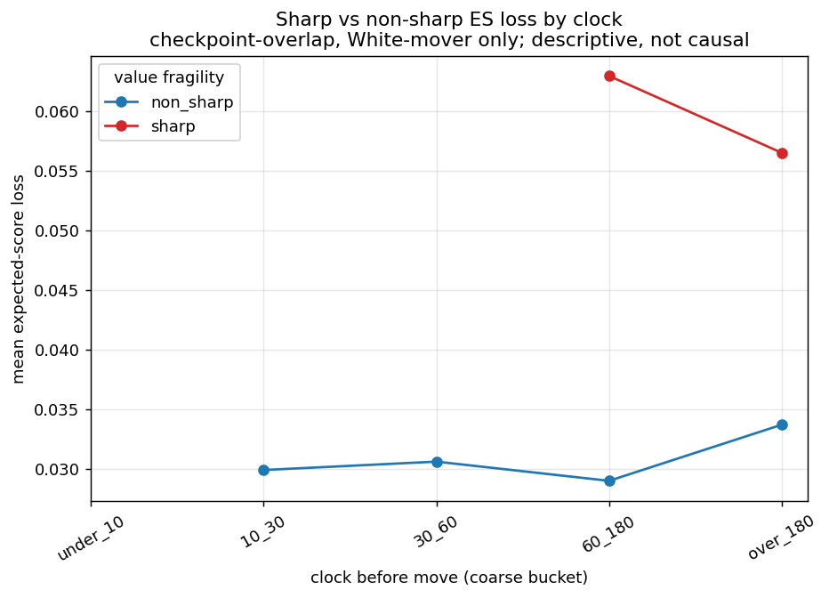
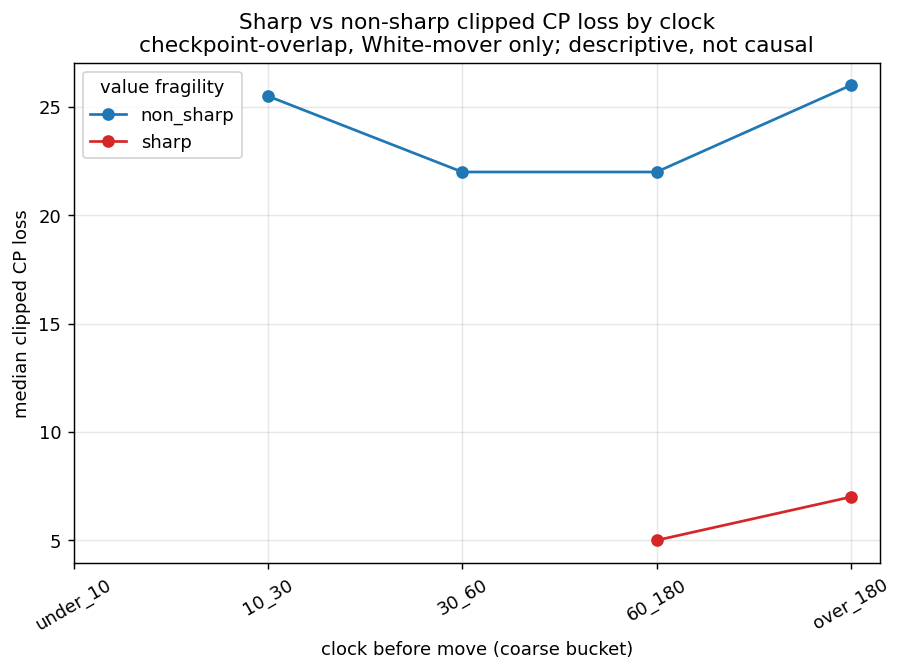
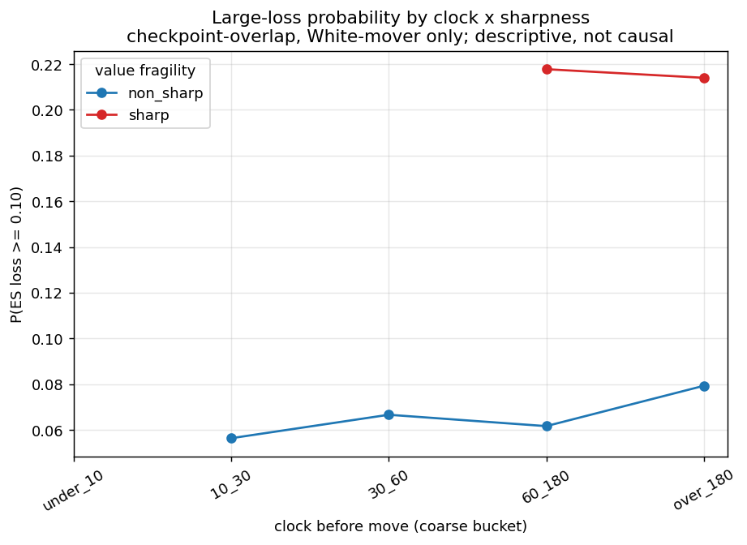
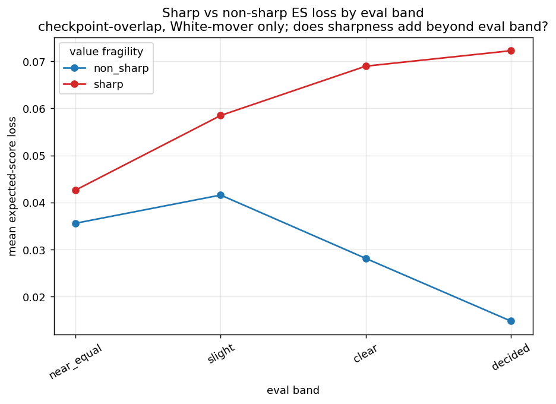
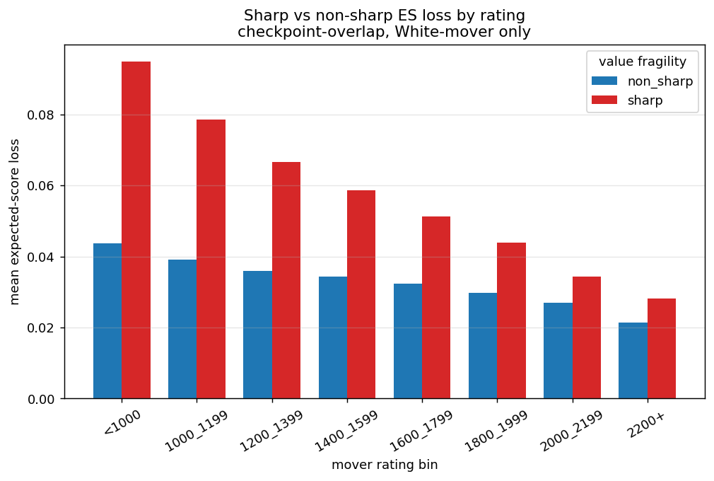
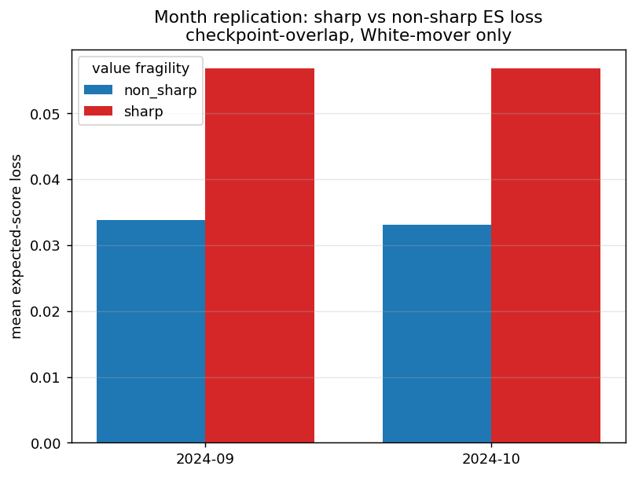

# Sharpness-Enriched Constraint Atlas — Existing Checkpoint Overlap, 10+0

**Ticket:** 15.5B | **checkpoint-overlap, White-mover only** | bootstrap 500 game-clustered draws, seed 20240617 | runtime 7s

## 1. Executive summary

Existing MultiPV sharpness (objective **value fragility**, NOT human obviousness) joined to the dense substrate on the corrected key `dense.ply = checkpoint_ply + 1`. Matched headline rows are **checkpoint-overlap, White-mover only** (121,165 rows = 4.36% of dense headline; see §3). Descriptively, sharp positions carry higher next-move loss; the focal **clock 60_180 × sharp** interaction = +0.0104 [+0.0018, +0.0194] * is **EXPLORATORY / no-claim** (sparse cells, §13). Sharpness main effect (at over_180) +0.0214 [+0.0198, +0.0231] *. **This does NOT resolve C3c** (directional/underpowered, not confirmed, not disproven). Predictive/descriptive, not causal; Stockfish/MultiPV is objective value context, not ground truth.

## 2. Inputs and validation
- Dense: 2,933,756 rows {'2024_09': 1496890, '2024_10': 1436866}; counts match 15.3C/15.3D; no usernames.
- Sharpness: 126,239 rows; checkpoint plies [20, 40, 60, 80]; side_to_move ['white']; no usernames.

## 3. Join semantics and coverage

Join key: `dense.game_id == sharpness.game_id AND dense.ply == checkpoint_ply + 1` (the White move played FROM the White-to-move checkpoint position). The naive `ply == checkpoint_ply` join is wrong (matches the Black move into the checkpoint).

| month | dense headline | matched | % | mover colors |
|---|---|---|---|---|
| 2024_09 | 1,416,313 | 64,371 | 4.54% | white only |
| 2024_10 | 1,362,459 | 61,868 | 4.54% | white only |
- Matched mover colors: ['white'] (White only by construction). **Checkpoint-overlap only; NOT dense-wide.**

## 4. Filtering and denominators
| month | dense rows | headline | mate-band excl | matched |
|---|---|---|---|---|
| 2024_09 | 1,496,890 | 1,416,313 | 80,577 | 64,371 |
| 2024_10 | 1,436,866 | 1,362,459 | 74,407 | 61,868 |
- Matched headline rows analysed: **121,165** (mate-band excluded 5,074).

## 5. Sharpness metric definitions
- Primary flag `sharp_value_fragility_v1` (objective value fragility: `n_good_10es<=2 ∧ worst_top5_loss_es>=0.10 ∧ legal_move_count>=8`); matched sharp rate 0.1414. **NOT human obviousness / difficulty.**

## 6. Sharp vs non-sharp expected-score loss by clock

| clock | sharp ES mean | non-sharp ES mean | sharp n | non-sharp n |
|---|---|---|---|---|
| under_10 | 0.0925 | 0.0338 | 17 | 162 |
| 10_30 | 0.0952 | 0.0299 | 49 | 390 |
| 30_60 | 0.0542 | 0.0306 | 113 | 825 |
| 60_180 | 0.0629 | 0.0290 | 675 | 4,506 |
| over_180 | 0.0565 | 0.0337 | 16,275 | 98,153 |

## 7. Sharp vs non-sharp clipped CP loss by clock

## 8. Large-loss probability by clock × sharpness

## 9. Eval-band-conditioned sharpness patterns

Checks whether value fragility adds information beyond eval band (it conditions on fragility within the engine's evaluation, a different axis).

## 10. Rating-conditioned sharpness patterns

## 11. Exploratory controlled clock × sharpness model

`expected_score_loss ~ clock(ref over_180) + sharp + clock×sharp + eval(ref decided) + phase + rating_bin + month + termination + anomaly` (mover_color omitted — constant White). 121,165 rows; 47,502 game clusters; 498/500 refits.

| contrast | estimate | 95% CI (game-clustered) |
|---|---|---|
| sharp main effect (at over_180) | +0.0214 | [+0.0198, +0.0231] * |
| clock 60_180 (at non-sharp) | +0.0010 | [-0.0006, +0.0028] |
| clock 60_180 x sharp (focal interaction) | +0.0104 | [+0.0018, +0.0194] * |
| clock 30_60 x sharp | +0.0002 | [-0.0198, +0.0195] |
| clock 10_30 x sharp | +0.0410 | [-0.0008, +0.0869] |
| clock under_10 x sharp | +0.0352 | [-0.0346, +0.1120] |

**The clock × sharp interactions are EXPLORATORY / no-claim** (sparse sharp×low-clock cells, §13). Board-decided-only focal interaction: +0.0056 [-0.0046, +0.0155].

## 12. Month replication

| contrast | 2024-09 | 2024-10 |
|---|---|---|
| sharp main effect (at over_180) | +0.0213 [+0.0189, +0.0235] * | +0.0215 [+0.0193, +0.0239] * |
| clock 60_180 x sharp (focal interaction) | +0.0095 [-0.0024, +0.0236] | +0.0113 [-0.0008, +0.0232] |

If the focal interaction sign/scale disagrees across months, replication is NOT claimed.

## 13. Sparse-cell and power diagnostics
| cell | sharp n | status |
|---|---|---|
| sharp × under_10 | 17 | sparse |
| sharp × 10_30 | 49 | sparse |
| sharp × 30_60 | 113 | sparse |
| sharp × 60_180 | 675 | exploratory |
| sharp × over_180 | 16,275 | headline |

Policy: n<200 sparse/no-claim; 200–999 exploratory; >=1000 headline-capable. The `sharp × 60_180` and lower-clock cells are exploratory/sparse — the same underpowered corner that left C3c unresolved.

## 14. Comparison to prior C3c result
- Phase 14 C3c (`clock=60_180 × sharp_value_fragility_v1`, checkpoint level): train+val pooled directional positive (~+0.010), test near zero, key cells underpowered → **not confirmed, not disproven**.
- This 15.5B checkpoint-overlap exploratory interaction: +0.0104 [+0.0018, +0.0194] * — exploratory/no-claim. **C3c status is unchanged.**

## 15. Interpretation
- Coverage is checkpoint-overlap, White-mover only (~4.4% of dense); not dense-wide.
- Sharp positions are descriptively higher-loss; whether the clock residual localizes to sharp positions is not resolvable here (sparse interaction cells).
- C3c remains unresolved; a stratified dense sharpness extraction (both colors, more low-clock sharp cells) would be needed to power the interaction — a separate ticket.
- Future diagnostic (NOT this ticket): a **Think-Time Loss-Rate / Flagging Signature Diagnostic** (cp/ES loss per unit think-time, board-decided vs time-forfeit).

## 16. Non-claims
Predictive/descriptive only; NOT causal. No "sharp positions cause blunders"; no "low clock causes blunders"; no "time pressure causes worse reasoning". Sharpness = objective value fragility, NOT human obviousness/difficulty; MultiPV/Stockfish is not ground truth. Checkpoint-overlap, White-mover only — NOT a dense-wide sharpness analysis. C3c not confirmed, not disproven. C4 and C3c unchanged.

## 17. Recommended next ticket
**15.5C — Sharpness Result Consolidation / C3c Claim Update** (consolidate this checkpoint-overlap result; decide whether a stratified dense sharpness extraction is warranted). Not Phase 16; not synthesis.

## Figure manifest
- `figures/phase_15_5_sharpness_enriched_atlas/fig_15_5_01_sharp_vs_nonsharp_es_loss_by_clock.png`
- `figures/phase_15_5_sharpness_enriched_atlas/fig_15_5_02_sharp_vs_nonsharp_clipped_cp_by_clock.png`
- `figures/phase_15_5_sharpness_enriched_atlas/fig_15_5_03_large_loss_probability_clock_sharpness.png`
- `figures/phase_15_5_sharpness_enriched_atlas/fig_15_5_04_eval_band_sharpness_es_loss.png`
- `figures/phase_15_5_sharpness_enriched_atlas/fig_15_5_05_rating_sharpness_es_loss.png`
- `figures/phase_15_5_sharpness_enriched_atlas/fig_15_5_06_month_replication_summary.png`
